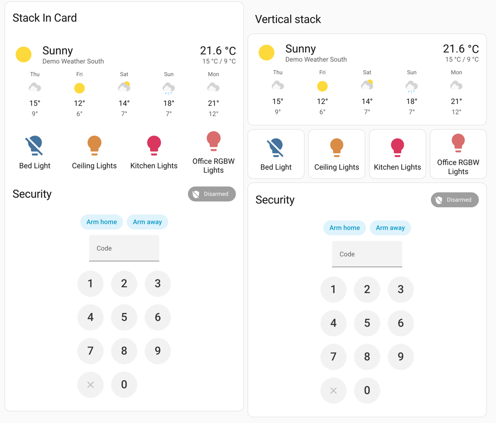
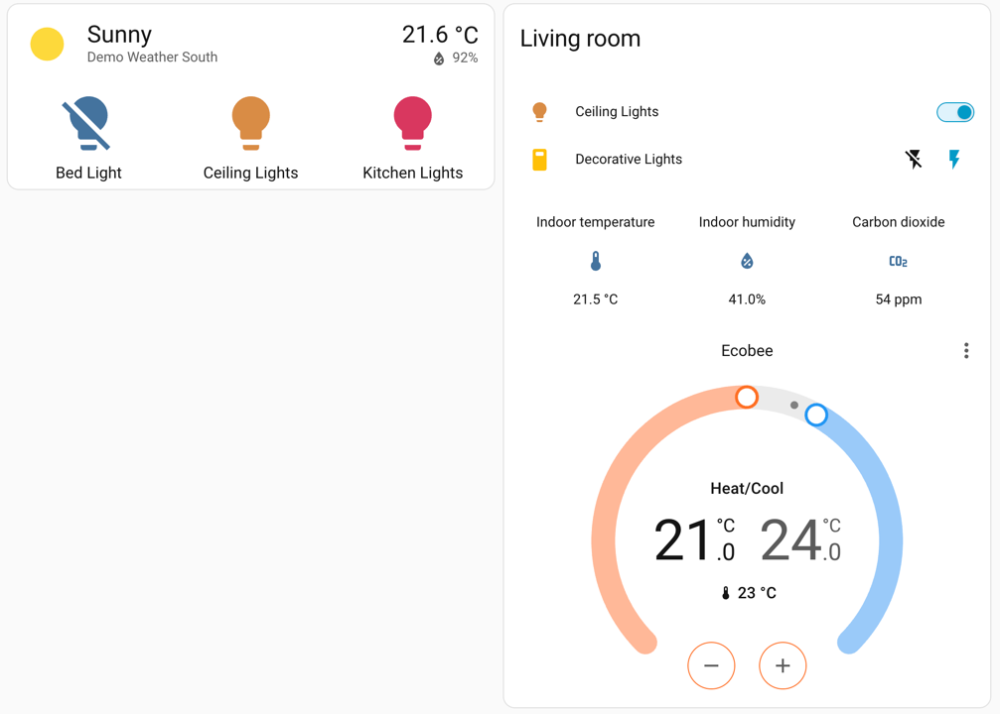
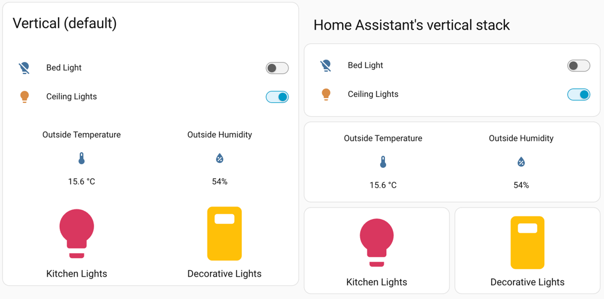
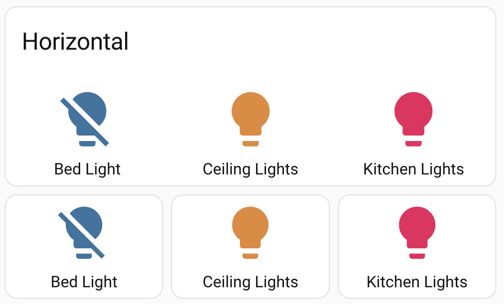

# Stack In Card

[](https://github.com/I-Simen-I/stack-in-card/releases/latest)
[](https://github.com/I-Simen-I/stack-in-card/commits/master)
[](#marketplace-recommended)

Group several cards into one card on your [Home Assistant](https://www.home-assistant.io/) dashboards, without the borders, shadows and gaps between them.



> A fork of [stack-in-card](https://github.com/custom-cards/stack-in-card) by [@RomRider](https://github.com/RomRider), kept up to date with current Home Assistant releases.

## Features

- **One card from many**: stack any cards vertically or horizontally, and they look like one card
- **Nested stacks**: horizontal and vertical stacks inside the card, and other stack-in-cards, are merged too
- **No flicker**: Home Assistant's cards are merged before they're shown, so their borders never flash on page load
- **Nothing to tune**: backgrounds, borders, rounded corners, shadows and gaps of the cards inside are always removed
- **Visual editor** with Home Assistant's own card tabs, in your Home Assistant language
- **Small**: about 6 KB, without dependencies
- A drop-in replacement for [vertical-stack-in-card](https://github.com/ofekashery/vertical-stack-in-card) and `horizontal-stack-in-card`

## Installation

Requires Home Assistant 2026.4 or newer.

### Marketplace (recommended)

From Home Assistant 2026.11, HACS is built in as the **Marketplace** (Settings → Marketplace). On older versions, use [HACS](https://hacs.xyz/); the steps are the same.

[](https://my.home-assistant.io/redirect/hacs_repository/?owner=I-Simen-I&repository=stack-in-card&category=plugin)

1. Click the button above, or add `https://github.com/I-Simen-I/stack-in-card` as a custom repository of type **Dashboard**. In the Marketplace, adding custom repositories needs a connection to GitHub.
2. Download **Stack In Card**.
3. Reload your browser.

### Manual

1. Download `stack-in-card.js` from the [latest release](https://github.com/I-Simen-I/stack-in-card/releases/latest) and copy it to your `config/www` folder. If the folder doesn't exist, create it and restart Home Assistant, which only serves `/local/` from a folder that existed when it started.
2. Add it as a resource: Settings → Dashboards → ⋮ → Resources → Add resource, with URL `/local/stack-in-card.js` and type **JavaScript module**.
3. Reload your browser.

### Migrating from the original card

1. Remove the original Stack In Card in the Marketplace (or HACS), or its file and resource if you installed it manually.
2. Install this card as described above.
3. Existing card configs keep working, but the cards inside always merge into one:
   - `keep` and the `--keep-background` CSS variable are ignored. Backgrounds, borders, rounded corners, shadows and gaps are always removed. The visual editor removes `keep` from the config.
   - Borders and the gap between the cards are removed again; they showed in the original card on newer Home Assistant versions.
   - A nested `custom:stack-in-card` merges into the outer one too.

## Configuration

### Visual editor

Add the card from the card picker; it starts with a weather card above three buttons side by side. In the editor, choose the layout (vertical or horizontal stack), set a title, and add, move, copy and edit the cards with the same tabs as Home Assistant's own stacks.

### YAML

Add the cards to stack under `cards`, as you would in a vertical stack:

```yaml
type: custom:stack-in-card
cards:
  - type: weather-forecast
    entity: weather.home
  - type: entities
    entities:
      - light.living_room
```

#### Card options

| Name    | Type   | Default      | Since  | Description                |
| ------- | ------ | ------------ | ------ | -------------------------- |
| `type`  | string | **required** | v0.0.1 | `custom:stack-in-card`     |
| `cards` | list   | **required** | v0.0.1 | The cards to stack         |
| `mode`  | string | `vertical`   | v0.0.1 | `vertical` or `horizontal` |
| `title` | string |              | v0.0.1 | Title above the cards      |

The cards inside always lose their background, border, rounded corners, shadow and the space between them; there are no options for it. To keep the look of one card anyway, override it on that card with [card-mod](https://github.com/thomasloven/lovelace-card-mod) and `!important`:

```yaml
card_mod:
  style: |
    ha-card { background: var(--primary-color) !important; }
```

## Examples

### Weather with a row of buttons, and a room



The row of buttons is a `horizontal-stack` inside the card; nested stacks are merged too.

```yaml
type: custom:stack-in-card
cards:
  - type: weather-forecast
    entity: weather.home
  - type: horizontal-stack
    cards:
      - type: button
        entity: light.bedroom
      - type: button
        entity: light.ceiling_lights
      - type: button
        entity: light.kitchen
```

```yaml
type: custom:stack-in-card
title: Living room
cards:
  - type: entities
    entities:
      - light.ceiling_lights
      - switch.decorative_lights
  - type: glance
    entities:
      - sensor.indoor_temperature
      - sensor.indoor_humidity
      - sensor.carbon_dioxide
  - type: thermostat
    entity: climate.living_room
```

### Compared with Home Assistant's stacks

The same cards in Stack In Card (left) and Home Assistant's vertical stack (right):



```yaml
type: custom:stack-in-card
title: Vertical (default)
cards:
  - type: entities
    entities:
      - light.bed_light
      - light.ceiling_lights
  - type: glance
    entities:
      - sensor.outside_temperature
      - sensor.outside_humidity
  - type: horizontal-stack
    cards:
      - type: button
        entity: light.kitchen_lights
      - type: button
        entity: switch.decorative_lights
```

### Horizontal

Stack In Card with `mode: horizontal` (top) and Home Assistant's horizontal stack (bottom):



```yaml
type: custom:stack-in-card
title: Horizontal
mode: horizontal
cards:
  - type: button
    entity: light.bed_light
  - type: button
    entity: light.ceiling_lights
  - type: button
    entity: light.kitchen_lights
```

## Translations

The visual editor uses Home Assistant's own translations, so it follows your Home Assistant language without translations of its own.

## Troubleshooting

- **"Custom element doesn't exist: stack-in-card"**: the card isn't loaded. Check that it's installed in the Marketplace (or HACS), or added as a resource if you installed it manually, then reload your browser.
- **Changes don't show after an update**: your browser is using a cached copy. Reload without cache (Ctrl+Shift+R or Cmd+Shift+R), or clear the cache in the Home Assistant app.
- **A card still has a background or border**: cards that style themselves, instead of using Home Assistant's card styles, are merged just after they're shown, and again after half a second. A custom card that loads slower than that can be missed; reload the page.
- **A card loses its own background color** (like a colored button-card or a weather backdrop): that's by design, the cards inside always merge. Override it with card-mod and `!important`, see [Card options](#card-options).

Still stuck? [Open an issue](https://github.com/I-Simen-I/stack-in-card/issues).

## Development

Requires Node 24 or newer and Yarn 4 via Corepack. Node 25 and newer no longer include Corepack, so install it separately (for example `brew install corepack` or `npm install -g corepack`) and run `corepack enable`.

```bash
yarn install     # install dependencies
yarn build       # build dist/stack-in-card.js
yarn watch       # rebuild on changes
yarn typecheck   # TypeScript
yarn lint        # ESLint and Prettier
yarn test        # smoke tests of the built card
yarn ha:up       # local Home Assistant with demo data on http://localhost:8124 (needs Docker and a build)
```

The local test environment and the release process are described in [`dev/README.md`](dev/README.md).

Built with TypeScript and webpack, without runtime dependencies.

## License

[MIT](LICENSE)
